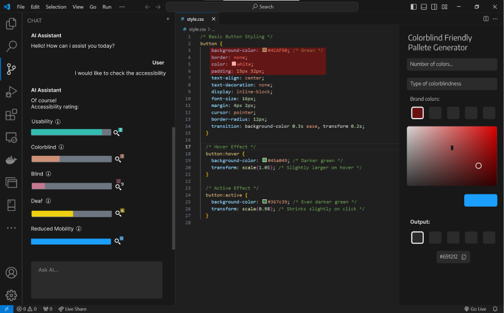
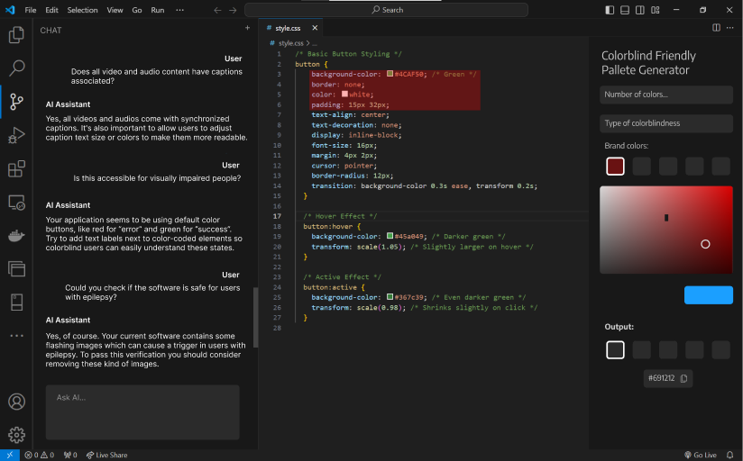

# Access AI

**An AI-powered accessibility assistant for developers, integrated into Visual Studio Code.**

Access AI is a prototype designed to help developers build more accessible and inclusive software. It provides an AI-powered chatbot where developers can ask accessibility-related questions and receive guidance on improving the usability of their applications.

The project explores how generative AI can support accessibility awareness and help developers consider the needs of people with visual, hearing, motor, and cognitive impairments.

## Vision

The vision behind Access AI is to make digital accessibility an integral part of software development.

Accessibility should not be an afterthought. Developers should have accessible guidance and practical recommendations throughout the development process, helping them create applications that are easier to use for everyone.

Access AI aims to reduce the effort required to understand accessibility best practices by bringing AI assistance directly into the development environment.

## Features

### AI-Powered Accessibility Chatbot

- Chat interface integrated into Visual Studio Code through a custom extension.
- Conversational interaction for accessibility-related questions.
- Google Gemini integration for AI-generated responses.
- Conversation history maintained during the active chat session.
- Markdown rendering for chatbot responses.

### Accessibility Guidance

The prototype explores accessibility topics affecting different user groups, including:

- **Visual impairments:** blindness and colour vision deficiencies.
- **Hearing impairments:** accessibility of audio content and captions.
- **Motor impairments:** usability of interactive elements and controls.
- **Cognitive impairments:** clarity and usability of digital interfaces.

### Accessibility Prototypes

The initial design phase also explored:
- Accessibility evaluation across different types of impairments.
- Colourblind-friendly colour palette generation.
- Custom palettes based on the type of colour vision deficiency, number of colours, and brand colours.

These concepts are part of the project's initial prototypes and vision, rather than features confirmed in the current extension implementation.

## Screenshots

The following images illustrate the initial interface prototypes.

### Accessibility Evaluation



### Interactive Accessibility Assistant



## Architecture

The implemented prototype combines a Visual Studio Code extension, a webview-based chat interface, and a Python backend.

```text
Access AI
│
├── dsle2414/
│   └── src/
│       └── access-ai/
│           ├── src/
│           │   ├── extension.ts
│           │   ├── frontend/
│           │   │   ├── webviewContent.ts
│           │   │   ├── script.js
│           │   │   └── style.css
│           │   ├── gemini/
│           │   │   ├── app.py
│           │   │   └── your_file.txt
│           │   └── test/
│           ├── package.json
│           └── tsconfig.json
│
└── mockups/
    ├── Mockup1.png
    └── Mockup2.png
```

### Technology Stack

| Technology | Purpose |
|---|---|
| TypeScript | Visual Studio Code extension |
| JavaScript | Chat interface interactions |
| HTML & CSS | Webview user interface |
| Python | Backend API |
| Flask | HTTP endpoint for chatbot requests |
| Google Gemini | AI-generated responses |
| Node.js & npm | Extension dependencies and build |

## Getting Started

### Prerequisites

- [Visual Studio Code](https://code.visualstudio.com/)
- [Node.js and npm](https://nodejs.org/)
- [Python 3](https://www.python.org/)
- A Google Gemini API key

### 1. Clone the repository

```bash
git clone https://github.com/JPsobral20/access-ai.git
cd access-ai
```

### 2. Set up the VS Code extension

Navigate to the extension directory:

```bash
cd dsle2414/src/access-ai
```

Install dependencies:

```bash
npm install
```

Compile the TypeScript source:

```bash
npm run compile
```

### 3. Set up the Python backend

Navigate to the Gemini backend directory:

```bash
cd src/gemini
```

Install the required Python packages:

```bash
pip install flask flask-cors google-generativeai
```

Configure your Gemini API key securely using an environment variable. The current prototype contains a hardcoded key, so the backend must be updated to read the key from the environment before running it safely.

### 4. Run the backend

Start the Flask server:

```bash
python app.py
```

The extension expects the backend to be available at:

```text
http://127.0.0.1:5000/submit
```

### 5. Launch the extension

1. Open the `dsle2414/src/access-ai` folder in Visual Studio Code.
2. Press `F5` to launch the Extension Development Host.
3. Open the Command Palette.
4. Run the **Access-ai** command to open the chatbot.

## Development and Testing

The extension includes scripts for compilation, linting, and testing:

```bash
npm run compile
npm run lint
npm test
```

## Project Context

This project was developed as part of the **Software Development Laboratory** course at the Faculty of Engineering of the University of Porto (FEUP).

It was developed collaboratively by Team 4, with the goal of exploring how artificial intelligence can contribute to more accessible and inclusive software development.

## Future Improvements

Potential directions for further development include:

- Automated accessibility evaluation of web applications.
- More detailed recommendations and suggested fixes.
- Integration of colourblind-friendly palette generation.
- Broader accessibility checks based on established guidelines.
- Improved chatbot context and support for different development workflows.

---

**Access AI — Making software development more inclusive, one interaction at a time.**
